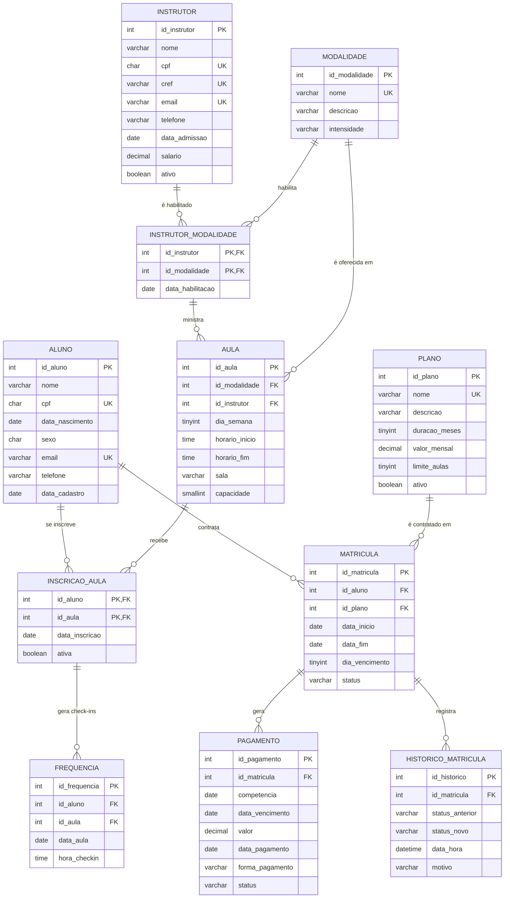

# Projeto de Banco de Dados — Sistema de Gestão de Academia

**Disciplina:** Banco de Dados · **Tema:** Gestão de Academia ("Academia Movimento", empresa fictícia)
**SGBD:** MySQL 8.0.16+ · **Grupo:** _(preencher nomes e RAs)_ · **Data:** novembro/2026

| Pasta / arquivo | Conteúdo |
|---|---|
| `Documentacao_Projeto_Academia.md` | Este documento (entregas 1 a 5 do professor) |
| `sql/01_criacao.sql` | Criação do banco: 11 tabelas, PK, FK, CHECK, UNIQUE, NOT NULL e DEFAULT |
| `sql/02_indices.sql` | 3 índices justificados |
| `sql/03_carga.sql` | Carga de **804 registros** fictícios |
| `sql/04_regras_e_transacao.sql` | 2 triggers de regra de negócio + procedure transacional + demonstração |
| `sql/05_consultas.sql` | 12 consultas (13 comandos SELECT) |
| `web/index.html` | Protótipo de interface (HTML, CSS, JS e Bootstrap) — bônus |

**Ordem de execução:** `01` → `02` → `03` → `05` (consultas) → `04` (transação, que altera dados).

---

## Sumário

1. [Proposta e requisitos](#1-proposta-e-requisitos)
2. [Modelagem conceitual](#2-modelagem-conceitual)
3. [Dicionário de dados](#3-dicionário-de-dados)
4. [Normalização](#4-normalização)
5. [Script SQL de criação](#5-script-sql-de-criação)
6. [Índices](#6-índices)
7. [Carga de dados](#7-carga-de-dados)
8. [Transação](#8-transação)
9. [Consultas SQL](#9-consultas-sql)
10. [Validação dos requisitos](#10-validação-dos-requisitos)
11. [Roteiro de apresentação](#11-roteiro-de-apresentação)
12. [Bônus: interface web](#12-bônus-interface-web)

---

## 1. Proposta e requisitos

### 1.1 Contextualização do problema

A Academia Movimento é uma academia de médio porte, com cerca de 30 alunos ativos nas aulas coletivas, 6 instrutores e 8 modalidades (Spinning, Yoga, Pilates, CrossFit, Zumba, Muay Thai, Funcional e Hidroginástica). Hoje ela controla tudo com planilhas e cadernos na recepção, o que causa problemas recorrentes:

- **Inadimplência sem controle:** não se sabe quem está com mensalidade atrasada nem há quantos dias. Alunos com atraso continuam frequentando.
- **Turmas superlotadas:** a recepção não sabe quantos alunos estão inscritos em cada aula, nem se o plano do aluno permite mais uma modalidade.
- **Instrutor sem habilitação:** já houve aulas atribuídas a instrutores sem formação naquela modalidade.
- **Falta de indicadores:** a gestão não sabe qual modalidade é mais procurada, qual instrutor tem mais alunos, qual é a receita mensal ou quais alunos pararam de vir (risco de evasão).
- **Dados duplicados e inconsistentes:** o mesmo aluno aparece com CPFs e e-mails diferentes em planilhas diferentes.

### 1.2 Objetivos do sistema

**Objetivo geral:** centralizar, num banco de dados relacional, as informações de alunos, planos, matrículas, aulas, frequência e pagamentos da academia, garantindo integridade dos dados e gerando relatórios para a gestão.

**Objetivos específicos:**

1. Cadastrar alunos, instrutores, planos e modalidades sem duplicidade.
2. Controlar o ciclo de vida da matrícula (ativa, suspensa, cancelada, encerrada) com histórico auditável.
3. Organizar a grade de aulas, garantindo que só instrutores habilitados ministrem cada modalidade.
4. Controlar inscrições em aulas respeitando a capacidade da turma e o limite do plano.
5. Registrar a frequência (check-in) dos alunos.
6. Controlar mensalidades, pagamentos e inadimplência.
7. Fornecer relatórios gerenciais: receita, ranking, frequência e evasão.

### 1.3 Usuários do sistema

| Usuário | Descrição | Principais ações |
|---|---|---|
| **Recepcionista** | Atende alunos no balcão | Cadastra alunos, faz matrículas, inscreve em aulas, recebe pagamentos |
| **Instrutor** | Ministra as aulas | Consulta sua grade e a lista de alunos, registra check-in |
| **Gerente / Proprietário** | Administra o negócio | Cadastra planos e modalidades, contrata instrutores, consulta relatórios financeiros e de desempenho |
| **Aluno** _(futuro: app)_ | Cliente | Consulta seu plano, suas aulas e suas mensalidades |

### 1.4 Requisitos funcionais (RF)

| Código | Requisito |
|---|---|
| RF01 | Cadastrar, alterar e consultar **alunos** (nome, CPF, nascimento, sexo, e-mail, telefone). |
| RF02 | Cadastrar, alterar e ativar/desativar **planos** (nome, duração, valor mensal, limite de modalidades). |
| RF03 | Cadastrar **instrutores** e registrar em quais **modalidades** cada um é habilitado. |
| RF04 | Cadastrar **modalidades** e montar a **grade de aulas** (dia, horário, sala, capacidade e instrutor). |
| RF05 | Realizar a **matrícula** do aluno em um plano, definindo o dia de vencimento. |
| RF06 | **Inscrever** o aluno em aulas e cancelar a inscrição. |
| RF07 | Registrar a **frequência** (check-in) do aluno numa aula. |
| RF08 | Gerar as **parcelas mensais** da matrícula e **registrar pagamentos**. |
| RF09 | **Suspender** a matrícula por inadimplência e **reativá-la** após a quitação. |
| RF10 | Manter o **histórico** de toda mudança de situação da matrícula. |
| RF11 | Emitir **relatórios**: receita por mês, pagamentos por período, inadimplência, ranking de instrutores, alunos mais frequentes, modalidade mais procurada e alunos em risco de evasão. |
| RF12 | Buscar alunos por nome, CPF ou e-mail. |

### 1.5 Requisitos não funcionais (RNF)

| Código | Categoria | Requisito |
|---|---|---|
| RNF01 | Tecnologia | Banco relacional **MySQL 8.0.16+**, engine **InnoDB** (transações ACID e FKs). |
| RNF02 | Integridade | Regras críticas implementadas **no próprio banco** (PK, FK, CHECK, UNIQUE, triggers), não só na aplicação. |
| RNF03 | Consistência | Operações financeiras executadas em **transação** (tudo ou nada). |
| RNF04 | Desempenho | Relatórios por período respondem em menos de 1 s com até 100 mil check-ins, com **índices** adequados. |
| RNF05 | Auditoria | Mudanças de situação da matrícula ficam registradas com data e hora, sem exclusão física. |
| RNF06 | Internacionalização | Charset **utf8mb4**, para suportar acentos e caracteres especiais. |
| RNF07 | Privacidade (LGPD) | Dados pessoais limitados ao necessário. CPF armazenado sem máscara e sem exposição em relatórios públicos. |
| RNF08 | Usabilidade | Interface web responsiva (desktop e celular). |
| RNF09 | Manutenibilidade | Modelo normalizado até a 3FN e nomes de restrições padronizados (`pk_`, `fk_`, `uk_`, `ck_`, `idx_`). |

### 1.6 Regras de negócio (RN)

| Código | Regra | Onde é garantida |
|---|---|---|
| RN01 | CPF e e-mail de aluno são únicos. O CPF tem 11 dígitos numéricos. | `UNIQUE` + `CHECK` (tabela `aluno`) |
| RN02 | Um aluno pode ter **no máximo uma matrícula vigente** (ATIVA ou SUSPENSA). | Coluna gerada `aluno_vigente` + `UNIQUE` |
| RN03 | Matrícula cancelada ou encerrada **deve ter data de término**. | `CHECK ck_matricula_fim` |
| RN04 | Só um instrutor **habilitado** na modalidade pode ministrar a aula. | FK composta `aula → instrutor_modalidade` |
| RN05 | Só aluno com matrícula **ATIVA** pode se inscrever em aulas. | Trigger `trg_inscricao_aula_bi` |
| RN06 | O aluno não pode exceder o **limite de modalidades do plano**. | Trigger `trg_inscricao_aula_bi` |
| RN07 | A inscrição numa aula respeita a **capacidade** da turma. | Trigger `trg_inscricao_aula_bi` |
| RN08 | O check-in precisa ser no **dia da semana da aula** e não pode ser futuro. | Trigger `trg_frequencia_bi` |
| RN09 | Só faz check-in quem tem **inscrição ativa** na aula e matrícula ATIVA. Suspenso não treina. | FK composta + trigger `trg_frequencia_bi` |
| RN10 | Um aluno registra **no máximo 1 presença** por aula por dia. | `UNIQUE (id_aluno, id_aula, data_aula)` |
| RN11 | Existe **uma única parcela por competência** (mês) para cada matrícula. | `UNIQUE (id_matricula, competencia)` |
| RN12 | Parcela **PAGA** tem obrigatoriamente data e forma de pagamento. Parcela não paga não tem nenhuma das duas. | `CHECK ck_pagamento_quitacao` |
| RN13 | Matrícula com parcela vencida há **mais de 15 dias** fica **SUSPENSA**. Ao quitar todas as parcelas atrasadas, volta a **ATIVA**. | Procedure `sp_registrar_pagamento` |
| RN14 | A 1ª parcela é paga **no ato da matrícula**. | Processo de matrícula (carga e interface) |
| RN15 | Toda mudança de situação da matrícula gera registro no **histórico**. | Procedure + tabela `historico_matricula` |
| RN16 | Registros com histórico **não são apagados**: usa-se exclusão lógica (`ativo`, `ativa`, `status`). | `FOREIGN KEY ... ON DELETE RESTRICT` |

---

## 2. Modelagem conceitual

### 2.1 Entidades

| Entidade | Tipo | Descrição |
|---|---|---|
| **Aluno** | Forte | Cliente da academia |
| **Plano** | Forte | Produto comercial (Mensal, Trimestral, Anual...) |
| **Instrutor** | Forte | Profissional de educação física (com CREF) |
| **Modalidade** | Forte | Tipo de atividade (Yoga, CrossFit...) |
| **Aula** | Forte | Turma semanal recorrente (ex.: Spinning, segunda, 07h, Estúdio Bike) |
| **Matrícula** | Associativa / evento | Contrato do aluno com um plano, com período e situação |
| **Instrutor_Modalidade** | Associativa (N:N) | Habilitação de um instrutor numa modalidade |
| **Inscrição_Aula** | Associativa (N:N) | Participação do aluno numa turma |
| **Frequência** | Fraca / evento | Check-in do aluno numa ocorrência da aula |
| **Pagamento** | Fraca / evento | Parcela mensal de uma matrícula |
| **Histórico_Matrícula** | Fraca / auditoria | Registro de cada mudança de situação da matrícula |

> As entidades da sugestão inicial (Aluno, Plano, Instrutor, Modalidade, Aula, Matrícula, Frequência e Pagamento) foram mantidas. Acrescentamos as duas associativas N:N e o histórico, exigido pela transação.

### 2.2 Diagrama Entidade-Relacionamento (notação pé-de-galinha)



> O diagrama é renderizado no GitHub, no VS Code (extensão *Markdown Preview Mermaid Support*) ou em [mermaid.live](https://mermaid.live). Para o slide, basta exportar como imagem.

### 2.3 Relacionamentos e cardinalidades

| # | Relacionamento | Cardinalidade | Tipo | Explicação |
|---|---|---|---|---|
| R1 | **Aluno** — contrata — **Matrícula** | Aluno (1,1) ↔ Matrícula (0,N) | **1:N** | Um aluno pode ter várias matrículas ao longo do tempo (renovações, troca de plano), mas cada matrícula pertence a um único aluno. Pela RN02, só uma pode estar vigente. |
| R2 | **Plano** — é contratado em — **Matrícula** | Plano (1,1) ↔ Matrícula (0,N) | **1:N** | Um plano é contratado por muitos alunos. Cada matrícula refere-se a um único plano. |
| R3 | **Matrícula** — gera — **Pagamento** | Matrícula (1,1) ↔ Pagamento (0,N) | **1:N** | Cada matrícula gera uma parcela por mês (competência). |
| R4 | **Matrícula** — registra — **Histórico** | Matrícula (1,1) ↔ Histórico (1,N) | **1:N** | Toda matrícula tem ao menos o registro de criação, mais um registro por mudança de situação. |
| R5 | **Instrutor** ↔ **Modalidade** (via *Instrutor_Modalidade*) | Instrutor (0,N) ↔ Modalidade (0,N) | **N:N** | Um instrutor é habilitado em várias modalidades e uma modalidade tem vários instrutores habilitados. Atributo do relacionamento: `data_habilitacao`. |
| R6 | **Modalidade** — é oferecida em — **Aula** | Modalidade (1,1) ↔ Aula (0,N) | **1:N** | Uma modalidade tem várias turmas (ex.: CrossFit segunda e sexta). |
| R7 | **Instrutor_Modalidade** — ministra — **Aula** | Habilitação (1,1) ↔ Aula (0,N) | **1:N** | Cada aula é ministrada por um instrutor **habilitado** naquela modalidade (FK composta). Indiretamente: Instrutor 1:N Aula. |
| R8 | **Aluno** ↔ **Aula** (via *Inscrição_Aula*) | Aluno (0,N) ↔ Aula (0,N) | **N:N** | Um aluno participa de várias turmas e uma turma tem vários alunos. Atributos: `data_inscricao` e `ativa`. |
| R9 | **Inscrição_Aula** — gera — **Frequência** | Inscrição (1,1) ↔ Frequência (0,N) | **1:N** | Cada inscrição acumula vários check-ins (um por dia de aula frequentado). |

**Resumo:** 7 relacionamentos **1:N** (R1, R2, R3, R4, R6, R7 e R9) e 2 relacionamentos **N:N** (R5 e R8), resolvidos com tabelas associativas.

---

## 3. Dicionário de dados

Legenda: **PK** chave primária · **FK** chave estrangeira · **UK** único · **Obr.** obrigatório (`NOT NULL`)

### 3.1 `plano`

| Campo | Tipo | Obr. | PK | FK | Descrição / restrições |
|---|---|:-:|:-:|:-:|---|
| id_plano | INT AUTO_INCREMENT | Sim | ✔ | | Identificador do plano |
| nome | VARCHAR(50) | Sim | | | Nome comercial. **UK** |
| descricao | VARCHAR(255) | Não | | | Benefícios do plano |
| duracao_meses | TINYINT | Sim | | | Fidelidade em meses. `CHECK IN (1,3,6,12)` |
| valor_mensal | DECIMAL(8,2) | Sim | | | Valor da mensalidade. `CHECK > 0` |
| limite_aulas | TINYINT | Sim | | | Nº máximo de modalidades coletivas. `DEFAULT 2`, `CHECK 1..7` |
| ativo | BOOLEAN | Sim | | | Se o plano ainda é vendido. `DEFAULT TRUE` |

### 3.2 `aluno`

| Campo | Tipo | Obr. | PK | FK | Descrição / restrições |
|---|---|:-:|:-:|:-:|---|
| id_aluno | INT AUTO_INCREMENT | Sim | ✔ | | Identificador do aluno |
| nome | VARCHAR(100) | Sim | | | Nome completo (índice `idx_aluno_nome`) |
| cpf | CHAR(11) | Sim | | | Somente dígitos. **UK**, `CHECK REGEXP '^[0-9]{11}$'` |
| data_nascimento | DATE | Sim | | | `CHECK >= '1920-01-01'` |
| sexo | CHAR(1) | Sim | | | `CHECK IN ('M','F','O')` |
| email | VARCHAR(120) | Sim | | | **UK**, `CHECK LIKE '%_@_%._%'` |
| telefone | VARCHAR(15) | Sim | | | Formato (99) 99999-9999 |
| data_cadastro | DATE | Sim | | | `DEFAULT (CURRENT_DATE)`, `CHECK > data_nascimento` |

### 3.3 `instrutor`

| Campo | Tipo | Obr. | PK | FK | Descrição / restrições |
|---|---|:-:|:-:|:-:|---|
| id_instrutor | INT AUTO_INCREMENT | Sim | ✔ | | Identificador do instrutor |
| nome | VARCHAR(100) | Sim | | | Nome completo |
| cpf | CHAR(11) | Sim | | | **UK**, 11 dígitos |
| cref | VARCHAR(15) | Sim | | | Registro no Conselho Regional de Educação Física. **UK** |
| email | VARCHAR(120) | Sim | | | E-mail corporativo. **UK** |
| telefone | VARCHAR(15) | Sim | | | Telefone de contato |
| data_admissao | DATE | Sim | | | Data de contratação |
| salario | DECIMAL(9,2) | Sim | | | `CHECK > 0` |
| ativo | BOOLEAN | Sim | | | Exclusão lógica. `DEFAULT TRUE` |

### 3.4 `modalidade`

| Campo | Tipo | Obr. | PK | FK | Descrição / restrições |
|---|---|:-:|:-:|:-:|---|
| id_modalidade | INT AUTO_INCREMENT | Sim | ✔ | | Identificador |
| nome | VARCHAR(50) | Sim | | | **UK** |
| descricao | VARCHAR(255) | Não | | | Descrição da atividade |
| intensidade | VARCHAR(10) | Sim | | | `DEFAULT 'MODERADA'`, `CHECK IN ('LEVE','MODERADA','ALTA')` |

### 3.5 `instrutor_modalidade` (associativa N:N)

| Campo | Tipo | Obr. | PK | FK | Descrição / restrições |
|---|---|:-:|:-:|:-:|---|
| id_instrutor | INT | Sim | ✔ | ✔ `instrutor` | Instrutor habilitado |
| id_modalidade | INT | Sim | ✔ | ✔ `modalidade` | Modalidade em que é habilitado |
| data_habilitacao | DATE | Sim | | | Data da certificação/habilitação |

### 3.6 `aula`

| Campo | Tipo | Obr. | PK | FK | Descrição / restrições |
|---|---|:-:|:-:|:-:|---|
| id_aula | INT AUTO_INCREMENT | Sim | ✔ | | Identificador da turma |
| id_modalidade | INT | Sim | | ✔ `modalidade` | Modalidade da turma |
| id_instrutor | INT | Sim | | ✔ `instrutor_modalidade`* | Instrutor responsável |
| dia_semana | TINYINT | Sim | | | 1 = domingo ... 7 = sábado (padrão `DAYOFWEEK`). `CHECK 1..7` |
| horario_inicio | TIME | Sim | | | Início da aula |
| horario_fim | TIME | Sim | | | `CHECK horario_fim > horario_inicio` |
| sala | VARCHAR(30) | Sim | | | Local. **UK** (sala, dia_semana, horario_inicio) |
| capacidade | SMALLINT | Sim | | | Vagas. `DEFAULT 20`, `CHECK 1..60` |

\* FK **composta** `(id_instrutor, id_modalidade) → instrutor_modalidade`, que garante a RN04. Também há **UK** `(id_instrutor, dia_semana, horario_inicio)`: o instrutor não pode estar em duas aulas no mesmo horário.

### 3.7 `matricula`

| Campo | Tipo | Obr. | PK | FK | Descrição / restrições |
|---|---|:-:|:-:|:-:|---|
| id_matricula | INT AUTO_INCREMENT | Sim | ✔ | | Identificador do contrato |
| id_aluno | INT | Sim | | ✔ `aluno` | Aluno contratante |
| id_plano | INT | Sim | | ✔ `plano` | Plano contratado |
| data_inicio | DATE | Sim | | | Início do contrato |
| data_fim | DATE | Não | | | Término. `CHECK >= data_inicio`. Obrigatória se CANCELADA/ENCERRADA |
| dia_vencimento | TINYINT | Sim | | | Dia do mês da mensalidade. `DEFAULT 10`, `CHECK 1..28` |
| status | VARCHAR(10) | Sim | | | `DEFAULT 'ATIVA'`, `CHECK IN ('ATIVA','SUSPENSA','CANCELADA','ENCERRADA')` |
| aluno_vigente | INT (gerada, STORED) | Não | | | **Coluna técnica**: `id_aluno` se a matrícula está vigente, senão NULL. **UK**, que garante a RN02 |

### 3.8 `inscricao_aula` (associativa N:N)

| Campo | Tipo | Obr. | PK | FK | Descrição / restrições |
|---|---|:-:|:-:|:-:|---|
| id_aluno | INT | Sim | ✔ | ✔ `aluno` | Aluno inscrito |
| id_aula | INT | Sim | ✔ | ✔ `aula` | Turma |
| data_inscricao | DATE | Sim | | | `DEFAULT (CURRENT_DATE)` |
| ativa | BOOLEAN | Sim | | | `FALSE` quando o aluno sai da turma. `DEFAULT TRUE` |

### 3.9 `frequencia`

| Campo | Tipo | Obr. | PK | FK | Descrição / restrições |
|---|---|:-:|:-:|:-:|---|
| id_frequencia | INT AUTO_INCREMENT | Sim | ✔ | | Identificador do check-in |
| id_aluno | INT | Sim | | ✔ `inscricao_aula`* | Aluno presente |
| id_aula | INT | Sim | | ✔ `inscricao_aula`* | Turma |
| data_aula | DATE | Sim | | | Dia em que a aula ocorreu (índice `idx_frequencia_data_aula`) |
| hora_checkin | TIME | Sim | | | Horário de chegada |

\* FK **composta** `(id_aluno, id_aula) → inscricao_aula`. **UK** `(id_aluno, id_aula, data_aula)` (RN10).

### 3.10 `pagamento`

| Campo | Tipo | Obr. | PK | FK | Descrição / restrições |
|---|---|:-:|:-:|:-:|---|
| id_pagamento | INT AUTO_INCREMENT | Sim | ✔ | | Identificador da parcela |
| id_matricula | INT | Sim | | ✔ `matricula` | Contrato a que a parcela pertence |
| competencia | DATE | Sim | | | Mês de referência (sempre dia 1). `CHECK DAY(competencia)=1`. **UK** (id_matricula, competencia) |
| data_vencimento | DATE | Sim | | | Vencimento desta parcela |
| valor | DECIMAL(8,2) | Sim | | | Valor cobrado. `CHECK > 0` |
| data_pagamento | DATE | Não | | | Data da quitação (NULL se em aberto) |
| forma_pagamento | VARCHAR(15) | Não | | | `CHECK IN ('PIX','CARTAO_CREDITO','CARTAO_DEBITO','DINHEIRO','BOLETO')` |
| status | VARCHAR(10) | Sim | | | `DEFAULT 'PENDENTE'`, `CHECK IN ('PENDENTE','PAGO','ATRASADO','CANCELADO')` + `ck_pagamento_quitacao` (RN12) |

### 3.11 `historico_matricula`

| Campo | Tipo | Obr. | PK | FK | Descrição / restrições |
|---|---|:-:|:-:|:-:|---|
| id_historico | INT AUTO_INCREMENT | Sim | ✔ | | Identificador do evento |
| id_matricula | INT | Sim | | ✔ `matricula` | Matrícula afetada |
| status_anterior | VARCHAR(10) | Não | | | NULL no evento de criação |
| status_novo | VARCHAR(10) | Sim | | | Situação após o evento |
| data_hora | DATETIME | Sim | | | `DEFAULT CURRENT_TIMESTAMP` |
| motivo | VARCHAR(255) | Sim | | | Descrição do evento |

> **Política de exclusão:** todas as FKs usam `ON DELETE RESTRICT ON UPDATE RESTRICT`. Numa academia, apagar um aluno ou plano com pagamentos destruiria o histórico financeiro. Por isso adotamos **exclusão lógica** (`ativo`, `ativa`, `status`).

---

## 4. Normalização

A normalização elimina redundâncias e anomalias de **inserção**, **atualização** e **exclusão**. Para mostrar o processo, partimos da forma como a academia guardava os dados: uma única planilha.

### 4.0 Ponto de partida: a planilha não normalizada (0FN)

`CONTROLE (cpf, nome_aluno, telefone, plano, valor_plano, duracao, modalidades, instrutores, horarios, presencas, pagamentos)`

| cpf | nome_aluno | plano | valor_plano | modalidades | instrutores | pagamentos |
|---|---|---|---|---|---|---|
| 529... | Lucas P. Campos | Anual Premium | 119,90 | Spinning, Zumba, Funcional | Juliana, Juliana, Carlos | 09/2026 pago; 10/2026 atrasado |

Problemas: campos **multivalorados** (modalidades, pagamentos), **grupos repetidos** e o mesmo valor do plano repetido para cada aluno.

### 4.1 Primeira Forma Normal (1FN)

> **Definição:** todos os atributos são **atômicos** (um único valor por célula), não há grupos repetitivos e cada tabela tem uma chave primária.

**O que foi feito:**
- `modalidades`, `instrutores`, `horarios`, `presencas` e `pagamentos` foram separados em linhas próprias.
- Nome, CPF e telefone viraram colunas atômicas (`telefone` armazena um único número).
- Datas viraram colunas `DATE`/`TIME`, em vez de textos como "10/2026 atrasado".

Resultado intermediário (1FN):
`ALUNO_AULA_PAGTO (cpf, id_aula, competencia, nome_aluno, telefone, plano, valor_plano, modalidade, instrutor, dia_semana, horario, data_pagamento, valor_pago, ...)`, com PK composta **(cpf, id_aula, competencia)**.

Está em 1FN, mas tem muita redundância: o nome do aluno se repete em todas as linhas, e o nome do instrutor em todas as linhas da aula.

### 4.2 Segunda Forma Normal (2FN)

> **Definição:** está na 1FN e **nenhum atributo não-chave depende de apenas parte de uma chave composta** (sem dependência funcional parcial).

Dependências **parciais** identificadas na tabela acima:

| Dependência | Problema | Solução |
|---|---|---|
| `cpf → nome_aluno, telefone, nascimento` | Depende só de parte da chave | Tabela **ALUNO** |
| `id_aula → modalidade, instrutor, dia_semana, horario, sala` | Depende só de parte da chave | Tabela **AULA** |
| `(cpf, competencia) → data_pagamento, valor_pago` | Não depende de `id_aula` | Tabela **PAGAMENTO** (ligada à matrícula) |
| `(cpf, id_aula) → data_inscricao` | Não depende de `competencia` | Tabela **INSCRICAO_AULA** |

As tabelas associativas do modelo final também estão em 2FN:

- `instrutor_modalidade (id_instrutor, id_modalidade, data_habilitacao)`: a data de habilitação depende **do par**. O mesmo instrutor tem datas diferentes para modalidades diferentes.
- `inscricao_aula (id_aluno, id_aula, data_inscricao, ativa)`: inscrição e situação dependem **do par** aluno-turma.
- Tabelas com PK simples (`aluno`, `aula`, `pagamento`...) estão automaticamente em 2FN, já que não há chave composta da qual depender parcialmente.

### 4.3 Terceira Forma Normal (3FN)

> **Definição:** está na 2FN e **nenhum atributo não-chave depende de outro atributo não-chave** (sem dependência transitiva). Ou seja, todo atributo depende "da chave, da chave inteira e de nada além da chave".

Dependências **transitivas** eliminadas:

| Situação na versão 2FN | Dependência transitiva | Solução no modelo final |
|---|---|---|
| `aluno` guardava `plano` e `valor_plano` | `id_aluno → plano → valor_plano` | Valor mora só em **PLANO**. Aluno e plano se ligam pela **MATRICULA** |
| `aula` guardava `nome_instrutor` e `cref` | `id_aula → id_instrutor → nome, cref` | Dados do instrutor só em **INSTRUTOR**. `aula` guarda apenas a FK |
| `aula` guardava `nome_modalidade` e `intensidade` | `id_aula → id_modalidade → intensidade` | Tabela **MODALIDADE** |
| `matricula` guardava `situacao_financeira` ("em dia"/"devendo") | Derivável das parcelas | Calculado por consulta (C11). Não é armazenado |
| `modalidade` guardaria `duracao_minutos` e `aula` guardaria `horario_fim` | `horario_fim = inicio + duração` | Mantido **apenas** `horario_fim` em `aula` |

### 4.4 Por que o modelo final está na 3FN — verificação tabela a tabela

| Tabela | Chave | Dependências funcionais | 3FN? |
|---|---|---|:-:|
| plano | id_plano | id_plano → nome, descricao, duracao, valor, limite, ativo (`nome` é chave candidata) | ✔ |
| aluno | id_aluno | id_aluno → todos os atributos. `cpf` e `email` são chaves candidatas, e dependências a partir de chaves candidatas não violam a 3FN | ✔ |
| instrutor | id_instrutor | idem (cpf, cref e email são chaves candidatas) | ✔ |
| modalidade | id_modalidade | id_modalidade → nome, descricao, intensidade | ✔ |
| instrutor_modalidade | (id_instrutor, id_modalidade) | par → data_habilitacao | ✔ |
| aula | id_aula | id_aula → modalidade, instrutor, dia, horários, sala, capacidade. Nenhum atributo descreve instrutor ou modalidade | ✔ |
| matricula | id_matricula | id_matricula → aluno, plano, datas, vencimento, status | ✔ |
| inscricao_aula | (id_aluno, id_aula) | par → data_inscricao, ativa | ✔ |
| frequencia | id_frequencia | id_frequencia → aluno, aula, data, hora (e (aluno, aula, data) é chave candidata) | ✔ |
| pagamento | id_pagamento | id_pagamento → matricula, competencia, vencimento, valor, pagamento, forma, status | ✔ |
| historico_matricula | id_historico | id_historico → matricula, status anterior/novo, data_hora, motivo | ✔ |

### 4.5 Decisões que parecem redundância, mas não são

Estas são as perguntas que um avaliador costuma fazer. Elas estão respondidas aqui:

1. **`pagamento.valor` não é cópia de `plano.valor_mensal`?** Não. É o valor **efetivamente cobrado naquele mês**: o preço do plano pode subir, e pode haver desconto ou multa. Se o valor viesse sempre do plano, um reajuste alteraria retroativamente toda a receita histórica, o que seria uma anomalia de atualização. Portanto `valor` depende de `id_pagamento`, e não de `id_plano`.
2. **`pagamento.data_vencimento` não é derivável de `competencia + matricula.dia_vencimento`?** Não necessariamente. A 1ª parcela vence no dia da matrícula (RN14), e vencimentos podem ser prorrogados. `matricula.dia_vencimento` é a *regra padrão* para gerar parcelas futuras. `data_vencimento` é o *fato* registrado em cada parcela.
3. **`matricula.aluno_vigente` (coluna gerada) viola a 3FN?** É uma **coluna técnica de controle**, calculada pelo SGBD e nunca digitada. Por isso não há risco de inconsistência. Ela existe porque o MySQL não tem índice único parcial (`UNIQUE ... WHERE`), e é ela que implementa a RN02 no banco.
4. **`frequencia` guarda `id_aluno` e `id_aula` em vez de um id de inscrição.** Esses dois campos *são* a chave da inscrição. A FK composta garante a integridade sem criar uma chave artificial extra.

---

## 5. Script SQL de criação

Arquivo completo: [`sql/01_criacao.sql`](sql/01_criacao.sql). Recursos exigidos e onde aparecem:

| Recurso | Exemplos no script |
|---|---|
| `CREATE TABLE` | 11 tabelas, todas com `ENGINE = InnoDB` |
| `PRIMARY KEY` | Simples (`pk_aluno`) e compostas (`pk_instrutor_modalidade`, `pk_inscricao_aula`) |
| `FOREIGN KEY` | 11 FKs, incluindo 2 **compostas** (`fk_aula_habilitacao`, `fk_frequencia_inscricao`) |
| `CHECK` | 25 CHECKs: domínio (`status IN ...`), faixa (`BETWEEN`), formato (`REGEXP`), coerência entre colunas (`horario_fim > horario_inicio`, `ck_pagamento_quitacao`) |
| `UNIQUE` | 12, incluindo compostos (`uk_aula_sala_horario`) e o UNIQUE sobre coluna gerada (`uk_matricula_vigente`) |
| `NOT NULL` | Todos os campos obrigatórios |
| `DEFAULT` | Literais (`'ATIVA'`, `TRUE`, `10`), `CURRENT_TIMESTAMP` e expressão `(CURRENT_DATE)` |

Trechos mais relevantes:

```sql
-- Matrícula: um único contrato vigente por aluno (RN02) e coerência de datas (RN03)
CREATE TABLE matricula (
    id_matricula    INT          NOT NULL AUTO_INCREMENT,
    id_aluno        INT          NOT NULL,
    id_plano        INT          NOT NULL,
    data_inicio     DATE         NOT NULL,
    data_fim        DATE         NULL,
    dia_vencimento  TINYINT      NOT NULL DEFAULT 10,
    status          VARCHAR(10)  NOT NULL DEFAULT 'ATIVA',
    aluno_vigente   INT GENERATED ALWAYS AS (
                        CASE WHEN status IN ('ATIVA', 'SUSPENSA') THEN id_aluno END
                    ) STORED,
    CONSTRAINT pk_matricula            PRIMARY KEY (id_matricula),
    CONSTRAINT uk_matricula_vigente    UNIQUE (aluno_vigente),
    CONSTRAINT ck_matricula_status     CHECK (status IN ('ATIVA','SUSPENSA','CANCELADA','ENCERRADA')),
    CONSTRAINT ck_matricula_vencimento CHECK (dia_vencimento BETWEEN 1 AND 28),
    CONSTRAINT ck_matricula_periodo    CHECK (data_fim IS NULL OR data_fim >= data_inicio),
    CONSTRAINT ck_matricula_fim        CHECK (status IN ('ATIVA','SUSPENSA') OR data_fim IS NOT NULL),
    CONSTRAINT fk_matricula_aluno FOREIGN KEY (id_aluno) REFERENCES aluno (id_aluno)
        ON DELETE RESTRICT ON UPDATE RESTRICT,
    CONSTRAINT fk_matricula_plano FOREIGN KEY (id_plano) REFERENCES plano (id_plano)
        ON DELETE RESTRICT ON UPDATE RESTRICT
) ENGINE = InnoDB;

-- Aula: só instrutor habilitado na modalidade (RN04), via FK composta
CONSTRAINT fk_aula_habilitacao FOREIGN KEY (id_instrutor, id_modalidade)
    REFERENCES instrutor_modalidade (id_instrutor, id_modalidade)

-- Pagamento: coerência entre situação, data e forma (RN12)
CONSTRAINT ck_pagamento_quitacao CHECK (
    (status = 'PAGO'  AND data_pagamento IS NOT NULL AND forma_pagamento IS NOT NULL)
 OR (status <> 'PAGO' AND data_pagamento IS NULL     AND forma_pagamento IS NULL)
)
```

**Regras que um CHECK não consegue expressar** (consultam outras tabelas ou a data atual) foram implementadas com **triggers** em [`sql/04_regras_e_transacao.sql`](sql/04_regras_e_transacao.sql):

| Trigger | Regras |
|---|---|
| `trg_inscricao_aula_bi` (BEFORE INSERT em `inscricao_aula`) | RN05 matrícula ATIVA · RN06 limite do plano · RN07 capacidade da turma |
| `trg_frequencia_bi` (BEFORE INSERT em `frequencia`) | RN08 dia da semana correto e data não futura · RN09 inscrição ativa e matrícula ATIVA |

> As triggers são criadas **depois** da carga porque a carga é uma importação de dados históricos. Ela contém, por exemplo, frequências de agosto de alunos que cancelaram depois.

---

## 6. Índices

Arquivo: [`sql/02_indices.sql`](sql/02_indices.sql).

> O InnoDB já cria índices automaticamente para **PK**, **UNIQUE** e colunas de **FK**. Por isso os índices abaixo cobrem padrões de busca que esses índices automáticos **não** atendem.

### Índice 1 — `idx_pagamento_status_data`

```sql
CREATE INDEX idx_pagamento_status_data ON pagamento (status, data_pagamento);
```

| Item | Descrição |
|---|---|
| **Objetivo** | Acelerar relatórios financeiros que filtram parcelas **pagas** num **intervalo de datas** |
| **Benefício esperado** | A igualdade (`status = 'PAGO'`) na 1ª coluna e o intervalo (`data_pagamento BETWEEN ...`) na 2ª permitem um *range scan*. O MySQL lê só as linhas pagas do período, em vez de varrer todas as parcelas (*full table scan*). A tabela cresce cerca de 12 linhas por aluno por ano, então com 2.000 alunos e 5 anos de histórico são aproximadamente 120 mil linhas. |
| **Consultas beneficiadas** | **C07** (pagamentos de setembro), **C07-B** (totais por forma) e **C09** (receita por mês) |
| **Por que nessa ordem?** | Num índice composto, colunas com **igualdade** vêm antes da coluna com **intervalo**. Com `(data_pagamento, status)`, o filtro de status não aproveitaria o índice de forma eficiente. |

### Índice 2 — `idx_frequencia_data_aula`

```sql
CREATE INDEX idx_frequencia_data_aula ON frequencia (data_aula, id_aula);
```

| Item | Descrição |
|---|---|
| **Objetivo** | Acelerar as análises de frequência **por período** |
| **Benefício esperado** | `frequencia` é a tabela que mais cresce: são 413 linhas em 3 meses com 30 alunos, o que daria mais de 100 mil por ano com 2.000 alunos. O índice `UNIQUE (id_aluno, id_aula, data_aula)` começa por `id_aluno` e **não serve** para `WHERE data_aula BETWEEN ...`. Este índice localiza o período direto e já entrega `id_aula` para a junção com `aula`/`modalidade`, funcionando como índice *cobridor* nessa parte. |
| **Consultas beneficiadas** | **C05** (evasão), **C06** (ranking de instrutores), **C08** (top 5), **C10** (modalidade mais procurada) e **C12** (ranking por modalidade) |

### Índice 3 — `idx_aluno_nome`

```sql
CREATE INDEX idx_aluno_nome ON aluno (nome);
```

| Item | Descrição |
|---|---|
| **Objetivo** | Busca de alunos por nome na recepção (RF12) |
| **Benefício esperado** | `WHERE nome LIKE 'Ana%'` (busca por prefixo) usa o B-Tree em vez de *full scan*. Também ajuda no `ORDER BY nome` das listagens. Obs.: `LIKE '%ana%'`, com curinga no início, **não** usa o índice. |
| **Consultas beneficiadas** | Tela "Consulta de alunos" e C02 (ordenada por nome) |

**Como comprovar na apresentação:**

```sql
EXPLAIN SELECT SUM(valor) FROM pagamento
 WHERE status = 'PAGO' AND data_pagamento BETWEEN '2026-09-01' AND '2026-09-30';
-- coluna key = idx_pagamento_status_data, type = range
```

> Com poucas linhas, o otimizador às vezes prefere o *full scan*, porque a tabela inteira cabe numa página. O ganho aparece com volume. Para forçar na demonstração: `... FROM pagamento FORCE INDEX (idx_pagamento_status_data) ...`.

---

## 7. Carga de dados

Arquivo: [`sql/03_carga.sql`](sql/03_carga.sql). A carga roda dentro de uma transação (`START TRANSACTION ... COMMIT`) e termina com uma consulta de conferência do volume.

### 7.1 Volume carregado — **804 registros**

| Tabela | Registros | Observação |
|---|--:|---|
| plano | 6 | 5 ativos + 1 descontinuado (`ativo = FALSE`) |
| modalidade | 8 | Spinning, Yoga, Pilates, CrossFit, Zumba, Muay Thai, Funcional, Hidroginástica |
| instrutor | 6 | Com CREF fictício |
| instrutor_modalidade | 12 | 2 habilitações por instrutor |
| aula | 12 | Grade de segunda a sábado |
| aluno | 30 | Nomes brasileiros fictícios, CPFs com dígito verificador válido |
| matricula | 30 | 25 ATIVAS, 3 SUSPENSAS, 2 CANCELADAS |
| inscricao_aula | 52 | Respeitam limite do plano e capacidade da turma |
| frequencia | 413 | Check-ins de 01/08 a 31/10/2026, sempre no dia da semana da aula |
| pagamento | 200 | Competências de mai/2026 a nov/2026: 167 PAGAS, 24 PENDENTES, 9 ATRASADAS |
| historico_matricula | 35 | 30 criações + 3 suspensões + 2 cancelamentos |
| **Total** | **804** | Requisito mínimo: 100 ✔ |

### 7.2 Cenários de negócio embutidos nos dados

Os dados foram desenhados para que **cada consulta tenha algo interessante a mostrar**:

| Cenário | Alunos envolvidos | Usado em |
|---|---|---|
| Suspenso por 1 parcela atrasada (alvo da transação) | Lucas Pereira Campos (matrícula 14, pagamento **#91**) | Seção 8 |
| Suspenso com várias parcelas atrasadas | Renan Tavares Lima (4), Gabriela Almeida Castro (2) | C11 |
| Ativo com atraso de 1 dia (vencimento em 05/11) | Daniel Oliveira Pires, Samuel Antunes Prado | C11 |
| Matrícula cancelada em 31/08/2026 | Isabela Araújo Cunha, Vinícius Lacerda Torres | C03, C10 (Hidroginástica) |
| Ativos que pararam de treinar em setembro | Helena, Natália, Rafaela | C05 |
| Plano descontinuado sem nenhum aluno | "Estudante (descontinuado)" | C03 (LEFT JOIN) |

**Data de referência ("hoje") da base: 06/11/2026.**

### 7.3 Amostra dos INSERTs

```sql
INSERT INTO plano (id_plano, nome, descricao, duracao_meses, valor_mensal, limite_aulas, ativo) VALUES
  (1, 'Mensal Essencial', 'Musculação livre + 1 modalidade coletiva', 1, 129.90, 1, TRUE),
  (2, 'Mensal Plus', 'Musculação livre + até 3 modalidades coletivas', 1, 179.90, 3, TRUE),
  (3, 'Trimestral', 'Fidelidade de 3 meses, até 2 modalidades', 3, 159.90, 2, TRUE),
  (4, 'Semestral', 'Fidelidade de 6 meses, até 3 modalidades', 6, 139.90, 3, TRUE),
  (5, 'Anual Premium', 'Fidelidade de 12 meses, até 4 modalidades e avaliação física', 12, 119.90, 4, TRUE),
  (6, 'Estudante (descontinuado)', 'Plano promocional encerrado em 2025', 1, 99.90, 1, FALSE);

INSERT INTO aula (id_aula, id_modalidade, id_instrutor, dia_semana, horario_inicio, horario_fim, sala, capacidade) VALUES
  (1, 1, 1, 2, '07:00', '07:50', 'Estúdio Bike', 20),
  (6, 4, 3, 2, '18:00', '19:00', 'Box', 18),
  ...
```

> Os dados foram gerados por um script determinístico, que valida todas as FKs e regras de negócio antes de gravar o arquivo. Por isso os resultados das consultas na Seção 9 são reproduzíveis.

---

## 8. Transação

Arquivo: [`sql/04_regras_e_transacao.sql`](sql/04_regras_e_transacao.sql).

### 8.1 A operação: **registrar pagamento** (`sp_registrar_pagamento`)

Quando um aluno quita uma mensalidade, o banco precisa executar várias operações que **só fazem sentido juntas**:

1. Ler e **bloquear** a parcela e a matrícula (`SELECT ... FOR UPDATE`).
2. Validar: a parcela existe? Está em aberto? A matrícula está vigente?
3. `UPDATE pagamento`: status `PAGO`, data e forma de pagamento.
4. Contar quantas parcelas ainda estão `ATRASADO`.
5. Se a matrícula estava `SUSPENSA` e não sobrou atraso, fazer `UPDATE matricula` para `ATIVA` (RN13).
6. `INSERT historico_matricula` (RN15).
7. `COMMIT`. Qualquer erro em qualquer passo dispara `ROLLBACK`.

```sql
DELIMITER $$
CREATE PROCEDURE sp_registrar_pagamento(
    IN p_id_pagamento    INT,
    IN p_forma_pagamento VARCHAR(15),
    IN p_data_pagamento  DATE
)
BEGIN
    DECLARE v_status_pag    VARCHAR(10) DEFAULT NULL;
    DECLARE v_id_matricula  INT         DEFAULT NULL;
    DECLARE v_status_mat    VARCHAR(10) DEFAULT NULL;
    DECLARE v_competencia   DATE        DEFAULT NULL;
    DECLARE v_atrasadas     INT         DEFAULT 0;

    -- Qualquer erro (SIGNAL, violação de CHECK/FK, deadlock...) desfaz tudo
    DECLARE EXIT HANDLER FOR SQLEXCEPTION
    BEGIN
        ROLLBACK;
        RESIGNAL;
    END;

    START TRANSACTION;

    SELECT p.status, p.id_matricula, p.competencia, m.status
      INTO v_status_pag, v_id_matricula, v_competencia, v_status_mat
      FROM pagamento p
      JOIN matricula m ON m.id_matricula = p.id_matricula
     WHERE p.id_pagamento = p_id_pagamento
       FOR UPDATE;

    IF v_status_pag IS NULL THEN
        SIGNAL SQLSTATE '45000' SET MESSAGE_TEXT = 'Pagamento inexistente.';
    END IF;
    IF v_status_pag NOT IN ('PENDENTE', 'ATRASADO') THEN
        SIGNAL SQLSTATE '45000' SET MESSAGE_TEXT = 'Parcela já quitada ou cancelada.';
    END IF;
    IF v_status_mat IN ('CANCELADA', 'ENCERRADA') THEN
        SIGNAL SQLSTATE '45000' SET MESSAGE_TEXT = 'Matrícula cancelada/encerrada não recebe pagamentos.';
    END IF;

    UPDATE pagamento
       SET status = 'PAGO', data_pagamento = p_data_pagamento, forma_pagamento = p_forma_pagamento
     WHERE id_pagamento = p_id_pagamento;

    SELECT COUNT(*) INTO v_atrasadas
      FROM pagamento WHERE id_matricula = v_id_matricula AND status = 'ATRASADO';

    IF v_status_mat = 'SUSPENSA' AND v_atrasadas = 0 THEN
        UPDATE matricula SET status = 'ATIVA' WHERE id_matricula = v_id_matricula;
        INSERT INTO historico_matricula (id_matricula, status_anterior, status_novo, motivo)
        VALUES (v_id_matricula, 'SUSPENSA', 'ATIVA',
                CONCAT('Reativada após quitação da parcela ', DATE_FORMAT(v_competencia, '%m/%Y'),
                       ' (pagamento #', p_id_pagamento, ' via ', p_forma_pagamento, ')'));
    ELSE
        INSERT INTO historico_matricula (id_matricula, status_anterior, status_novo, motivo)
        VALUES (v_id_matricula, v_status_mat, v_status_mat,
                CONCAT('Parcela ', DATE_FORMAT(v_competencia, '%m/%Y'), ' quitada (pagamento #',
                       p_id_pagamento, ' via ', p_forma_pagamento, '); parcelas ainda em atraso: ', v_atrasadas));
    END IF;

    COMMIT;
END$$
DELIMITER ;
```

### 8.2 Por que a transação é necessária

Sem transação, uma falha entre os passos deixaria o banco **inconsistente**:

| Falha no meio do processo | Consequência sem transação |
|---|---|
| Queda de energia após o passo 3 | Parcela **paga**, mas o aluno continua **suspenso**. Ele pagou e é barrado na catraca (trigger RN09). |
| Erro no INSERT do histórico | Situação da matrícula muda **sem registro de auditoria** (viola RN15). |
| Dois atendentes recebem a mesma parcela ao mesmo tempo | **Pagamento em dobro**. O `FOR UPDATE` bloqueia a linha e o 2º atendente espera e recebe o erro "Parcela já quitada". |

As propriedades **ACID** garantidas:

- **Atomicidade:** os 3 comandos de escrita acontecem todos ou nenhum.
- **Consistência:** CHECKs e regras são validados antes do COMMIT.
- **Isolamento:** `FOR UPDATE` impede leitura e escrita concorrente da mesma parcela.
- **Durabilidade:** após o `COMMIT`, o InnoDB grava no *redo log*.

### 8.3 Demonstração (4 cenários do script)

| Cenário | Comando | Resultado |
|---|---|---|
| **1 — Sucesso (COMMIT)** | `CALL sp_registrar_pagamento(91, 'PIX', '2026-11-06');` | Parcela #91 vira PAGO, a matrícula 14 (Lucas) passa de SUSPENSA para **ATIVA** e o histórico ganha "Reativada após quitação da parcela 10/2026..." |
| **2 — Regra de negócio (ROLLBACK)** | Repetir o `CALL` acima | **Erro 1644: "Parcela já quitada ou cancelada."** Nada é alterado e nenhum histórico é gravado. |
| **3 — Integridade (ROLLBACK)** | `CALL sp_registrar_pagamento(47, 'CHEQUE', '2026-11-06');` | O UPDATE viola `ck_pagamento_forma` (**erro 3819**). O handler faz ROLLBACK e a parcela #47 continua **ATRASADO**. |
| **4 — ROLLBACK manual** | `START TRANSACTION;` cancela a matrícula 22, cancela as parcelas e grava histórico, depois `ROLLBACK;` | Dentro da transação o SELECT mostra CANCELADA. Após o ROLLBACK volta tudo a **SUSPENSA**, com as 4 parcelas ATRASADAS. |

> **Dica para a apresentação no MySQL Workbench:** os cenários 2 e 3 geram erro de propósito. Execute bloco a bloco (Ctrl+Enter na linha) ou ative *"Continue on SQL Query Error"*.

---

## 9. Consultas SQL

Arquivo: [`sql/05_consultas.sql`](sql/05_consultas.sql). São **12 consultas**, sendo que a C07 tem uma variante B, totalizando 13 SELECTs. Os resultados abaixo foram obtidos executando as consultas sobre a carga da Seção 7, **antes** da demonstração transacional.

| # | Requisito do professor | Técnicas SQL |
|---|---|---|
| C01 | JOIN simples | `INNER JOIN`, `ELT`, `TIME_FORMAT` |
| C02 | JOIN múltiplo | 7 tabelas, JOIN com condição composta |
| C03 | GROUP BY | `LEFT JOIN` + `COUNT` + `GROUP BY` |
| C04 | HAVING | `COUNT(DISTINCT)`, `GROUP_CONCAT`, `HAVING` |
| C05 | Subconsulta | `NOT EXISTS` correlacionado + subconsulta escalar |
| C06 | Ranking | `RANK() OVER` |
| C07 | Consulta por período | `BETWEEN` em datas + `WITH ROLLUP` / `GROUPING()` |
| C08 | Top 5 alunos mais frequentes | `GROUP BY` + `ORDER BY` + `LIMIT` |
| C09 | Receita por mês | `DATE_FORMAT`, `SUM`, `AVG`, soma acumulada `SUM() OVER` |
| C10 | Modalidade mais procurada | CTEs (`WITH`), `LEFT JOIN`, `COALESCE`, `RANK` |
| C11 | Extra: inadimplência | `DATEDIFF`, `SUM() OVER (PARTITION BY)` |
| C12 | Extra: ranking por grupo | `DENSE_RANK() OVER (PARTITION BY)` |

---

### C01 — JOIN simples: grade semanal de aulas

```sql
SELECT a.id_aula,
       mo.nome                                         AS modalidade,
       ELT(a.dia_semana, 'Domingo', 'Segunda', 'Terça', 'Quarta',
                         'Quinta', 'Sexta', 'Sábado')   AS dia,
       TIME_FORMAT(a.horario_inicio, '%H:%i')          AS inicio,
       TIME_FORMAT(a.horario_fim,    '%H:%i')          AS fim,
       a.sala,
       a.capacidade
  FROM aula a
 INNER JOIN modalidade mo ON mo.id_modalidade = a.id_modalidade
 ORDER BY a.dia_semana, a.horario_inicio;
```

**Objetivo:** montar o quadro de horários da recepção, trocando o código da modalidade pelo nome.
**Resultado esperado:** 12 linhas, uma por turma, ordenadas de segunda a sábado.

| id_aula | modalidade | dia | inicio | fim | sala | capacidade |
|--:|---|---|---|---|---|--:|
| 1 | Spinning | Segunda | 07:00 | 07:50 | Estúdio Bike | 20 |
| 6 | CrossFit | Segunda | 18:00 | 19:00 | Box | 18 |
| 3 | Yoga | Terça | 08:00 | 09:00 | Sala Zen | 15 |
| 8 | Zumba | Terça | 19:00 | 20:00 | Sala 1 | 25 |
| 2 | Spinning | Quarta | 19:00 | 19:50 | Estúdio Bike | 20 |
| 9 | Muay Thai | Quarta | 20:00 | 21:00 | Tatame | 16 |
| 10 | Funcional | Quinta | 07:00 | 08:00 | Sala 1 | 20 |
| 4 | Pilates | Quinta | 09:00 | 10:00 | Sala Zen | 12 |
| 12 | Hidroginástica | Sexta | 08:00 | 09:00 | Piscina | 15 |
| 7 | CrossFit | Sexta | 18:00 | 19:00 | Box | 18 |
| 11 | Funcional | Sábado | 09:00 | 10:00 | Sala 1 | 20 |
| 5 | Pilates | Sábado | 10:00 | 11:00 | Sala Zen | 12 |

---

### C02 — JOIN múltiplo: ficha de treinos dos alunos ativos (7 tabelas)

```sql
SELECT al.nome AS aluno, pl.nome AS plano, mo.nome AS modalidade, ins.nome AS instrutor,
       ELT(au.dia_semana, 'Domingo','Segunda','Terça','Quarta','Quinta','Sexta','Sábado') AS dia,
       TIME_FORMAT(au.horario_inicio, '%H:%i') AS horario
  FROM aluno al
  JOIN matricula      ma  ON ma.id_aluno      = al.id_aluno AND ma.status = 'ATIVA'
  JOIN plano          pl  ON pl.id_plano      = ma.id_plano
  JOIN inscricao_aula ia  ON ia.id_aluno      = al.id_aluno AND ia.ativa  = TRUE
  JOIN aula           au  ON au.id_aula       = ia.id_aula
  JOIN modalidade     mo  ON mo.id_modalidade = au.id_modalidade
  JOIN instrutor      ins ON ins.id_instrutor = au.id_instrutor
 ORDER BY al.nome, au.dia_semana, au.horario_inicio;
```

**Objetivo:** mostrar, para cada aluno **ativo**, o plano, as turmas, os instrutores e os horários. É a "ficha de treino" impressa na recepção.
**Resultado esperado:** **43 linhas**. Alunos suspensos e cancelados ficam de fora por causa da condição `ma.status = 'ATIVA'` no JOIN. Primeiras linhas:

| aluno | plano | modalidade | instrutor | dia | horario |
|---|---|---|---|---|---|
| Alex Sandro Vidal | Trimestral | Spinning | Juliana Prado Costa | Quarta | 19:00 |
| Alex Sandro Vidal | Trimestral | CrossFit | Thiago Nogueira Alves | Sexta | 18:00 |
| Ana Beatriz Ferreira | Semestral | CrossFit | Rafael Augusto Teixeira | Segunda | 18:00 |
| Beatriz Leme Andrade | Mensal Plus | Spinning | Carlos Eduardo Mendes | Segunda | 07:00 |
| Beatriz Leme Andrade | Mensal Plus | Zumba | Juliana Prado Costa | Terça | 19:00 |
| … | … | … | … | … | … |

---

### C03 — GROUP BY: matrículas vigentes e receita prevista por plano

```sql
SELECT pl.nome AS plano, pl.valor_mensal,
       COUNT(ma.id_matricula)                   AS matriculas_vigentes,
       COUNT(ma.id_matricula) * pl.valor_mensal AS receita_mensal_prevista
  FROM plano pl
  LEFT JOIN matricula ma ON ma.id_plano = pl.id_plano
                        AND ma.status IN ('ATIVA', 'SUSPENSA')
 GROUP BY pl.id_plano, pl.nome, pl.valor_mensal
 ORDER BY matriculas_vigentes DESC, pl.nome;
```

**Objetivo:** saber quais planos vendem mais e quanto cada um deve gerar por mês.
**Resultado esperado:** 6 linhas. O `LEFT JOIN` faz aparecer também o plano descontinuado, com zero. Com `INNER JOIN` ele sumiria.

| plano | valor_mensal | matriculas_vigentes | receita_mensal_prevista |
|---|--:|--:|--:|
| Anual Premium | 119.90 | 11 | 1318.90 |
| Semestral | 139.90 | 6 | 839.40 |
| Mensal Plus | 179.90 | 4 | 719.60 |
| Trimestral | 159.90 | 4 | 639.60 |
| Mensal Essencial | 129.90 | 3 | 389.70 |
| Estudante (descontinuado) | 99.90 | 0 | 0.00 |

**Leitura:** o plano Anual concentra cerca de 39% das matrículas. Receita mensal prevista: **R$ 3.907,20**.

---

### C04 — HAVING: alunos que praticam 2 ou mais modalidades

```sql
SELECT al.nome AS aluno,
       COUNT(DISTINCT au.id_modalidade) AS qtd_modalidades,
       COUNT(*)                         AS qtd_turmas,
       GROUP_CONCAT(DISTINCT mo.nome ORDER BY mo.nome SEPARATOR ', ') AS modalidades
  FROM inscricao_aula ia
  JOIN aluno      al ON al.id_aluno      = ia.id_aluno
  JOIN aula       au ON au.id_aula       = ia.id_aula
  JOIN modalidade mo ON mo.id_modalidade = au.id_modalidade
 WHERE ia.ativa = TRUE
 GROUP BY al.id_aluno, al.nome
HAVING COUNT(DISTINCT au.id_modalidade) >= 2
 ORDER BY qtd_modalidades DESC, al.nome;
```

**Objetivo:** identificar alunos "multimodalidade", público-alvo para upgrade de plano. O `WHERE` filtra **linhas** antes do agrupamento. O `HAVING` filtra **grupos** depois.
**Resultado esperado:** **14 alunos**, sendo 7 com 3 modalidades e 7 com 2. Destaque: *Caio Rezende Matos* tem **3 turmas e apenas 2 modalidades**, porque faz CrossFit na segunda e na sexta. Por isso usamos `COUNT(DISTINCT)`.

| aluno | qtd_modalidades | qtd_turmas | modalidades |
|---|--:|--:|---|
| Eduarda Carvalho Lopes | 3 | 3 | CrossFit, Funcional, Spinning |
| Larissa Monteiro Vieira | 3 | 3 | CrossFit, Funcional, Spinning |
| Lucas Pereira Campos | 3 | 3 | Funcional, Spinning, Zumba |
| … | … | … | … |
| Caio Rezende Matos | 2 | 3 | CrossFit, Pilates |
| … | … | … | … |

---

### C05 — Subconsulta: alunos ativos em risco de evasão

```sql
SELECT al.id_aluno, al.nome, al.telefone, pl.nome AS plano,
       (SELECT MAX(f2.data_aula) FROM frequencia f2
         WHERE f2.id_aluno = al.id_aluno) AS ultima_presenca      -- subconsulta escalar
  FROM aluno al
  JOIN matricula ma ON ma.id_aluno = al.id_aluno AND ma.status = 'ATIVA'
  JOIN plano     pl ON pl.id_plano = ma.id_plano
 WHERE NOT EXISTS (                                                -- subconsulta correlacionada
         SELECT 1 FROM frequencia f
          WHERE f.id_aluno = al.id_aluno
            AND f.data_aula BETWEEN '2026-10-01' AND '2026-10-31')
 ORDER BY ultima_presenca;
```

**Objetivo:** listar quem **paga, mas não aparece**. Esses alunos tendem a cancelar, e a recepção deve ligar para eles. Usa duas subconsultas: `NOT EXISTS` correlacionada no filtro e uma escalar na projeção.
**Resultado esperado:** 3 alunos sem nenhum check-in em outubro:

| id_aluno | nome | telefone | plano | ultima_presenca |
|--:|---|---|---|---|
| 21 | Rafaela Mendonça Reis | (11) 95899-7107 | Trimestral | 2026-09-11 |
| 9 | Helena Cardoso Freitas | (11) 94047-7389 | Semestral | 2026-09-16 |
| 17 | Natália Soares Fonseca | (11) 97293-7179 | Semestral | 2026-09-21 |

---

### C06 — Ranking de instrutores por presenças

```sql
SELECT RANK() OVER (ORDER BY COUNT(f.id_frequencia) DESC) AS posicao,
       i.nome AS instrutor,
       COUNT(DISTINCT a.id_aula)  AS turmas,
       COUNT(f.id_frequencia)     AS presencas,
       COUNT(DISTINCT f.id_aluno) AS alunos_distintos
  FROM instrutor i
  JOIN aula a            ON a.id_instrutor = i.id_instrutor
  LEFT JOIN frequencia f ON f.id_aula = a.id_aula
                        AND f.data_aula BETWEEN '2026-08-01' AND '2026-10-31'
 GROUP BY i.id_instrutor, i.nome
 ORDER BY posicao;
```

**Objetivo:** medir a "audiência" de cada instrutor no trimestre, para premiação ou redistribuição de turmas. `RANK()` dá a mesma posição a empates e pula a seguinte.
**Resultado esperado:**

| posicao | instrutor | turmas | presencas | alunos_distintos |
|--:|---|--:|--:|--:|
| 1 | Thiago Nogueira Alves | 2 | 99 | 10 |
| 2 | Rafael Augusto Teixeira | 2 | 96 | 12 |
| 3 | Carlos Eduardo Mendes | 2 | 88 | 11 |
| 4 | Juliana Prado Costa | 2 | 82 | 10 |
| 5 | Patrícia Moura Santos | 2 | 29 | 4 |
| 6 | Fernanda Lima Rocha | 2 | 19 | 3 |

**Leitura:** os instrutores de CrossFit (Thiago e Rafael) lideram. Fernanda (Yoga/Pilates de manhã) tem baixa adesão, o que sugere rever horários.

---

### C07 — Consulta por período: pagamentos recebidos em setembro/2026

```sql
SELECT pg.id_pagamento, al.nome AS aluno, pl.nome AS plano,
       DATE_FORMAT(pg.competencia, '%m/%Y') AS competencia,
       pg.data_pagamento, pg.forma_pagamento, pg.valor
  FROM pagamento pg
  JOIN matricula ma ON ma.id_matricula = pg.id_matricula
  JOIN aluno     al ON al.id_aluno     = ma.id_aluno
  JOIN plano     pl ON pl.id_plano     = ma.id_plano
 WHERE pg.status = 'PAGO'
   AND pg.data_pagamento BETWEEN '2026-09-01' AND '2026-09-30'
 ORDER BY pg.data_pagamento, al.nome;
```

**Objetivo:** conciliação financeira do mês (o que entrou no caixa em setembro).
**Resultado esperado:** **28 pagamentos**. Note que 2 são da competência **10/2026**, pagos antecipadamente em 29/09. O filtro é pela data do pagamento (regime de caixa).

| id_pagamento | aluno | plano | competencia | data_pagamento | forma_pagamento | valor |
|--:|---|---|---|---|---|--:|
| 26 | Daniel Oliveira Pires | Anual Premium | 09/2026 | 2026-09-01 | PIX | 119.90 |
| 192 | Beatriz Leme Andrade | Mensal Plus | 09/2026 | 2026-09-04 | CARTAO_CREDITO | 179.90 |
| … | … | … | … | … | … | … |
| 41 | Felipe Gomes Ribeiro | Semestral | 10/2026 | 2026-09-29 | CARTAO_CREDITO | 139.90 |

**C07-B — totalizador do período com `WITH ROLLUP`:**

```sql
SELECT IF(GROUPING(forma_pagamento) = 1, 'TOTAL GERAL', forma_pagamento) AS forma_pagamento,
       COUNT(*) AS quantidade, SUM(valor) AS total_recebido
  FROM pagamento
 WHERE status = 'PAGO' AND data_pagamento BETWEEN '2026-09-01' AND '2026-09-30'
 GROUP BY forma_pagamento WITH ROLLUP;
```

| forma_pagamento | quantidade | total_recebido |
|---|--:|--:|
| BOLETO | 2 | 279.80 |
| CARTAO_CREDITO | 9 | 1269.10 |
| CARTAO_DEBITO | 5 | 699.50 |
| PIX | 12 | 1618.80 |
| **TOTAL GERAL** | **28** | **3867.20** |

---

### C08 — Top 5 alunos mais frequentes (ago–out/2026)

```sql
SELECT al.nome AS aluno, COUNT(*) AS presencas,
       COUNT(DISTINCT f.id_aula) AS turmas, MAX(f.data_aula) AS ultima_presenca
  FROM frequencia f
  JOIN aluno al ON al.id_aluno = f.id_aluno
 WHERE f.data_aula BETWEEN '2026-08-01' AND '2026-10-31'
 GROUP BY al.id_aluno, al.nome
 ORDER BY presencas DESC, al.nome
 LIMIT 5;
```

**Objetivo:** reconhecer os alunos mais assíduos (programa de fidelidade, brindes).
**Resultado esperado:**

| aluno | presencas | turmas | ultima_presenca |
|---|--:|--:|---|
| Caio Rezende Matos | 36 | 3 | 2026-10-31 |
| Eduarda Carvalho Lopes | 36 | 3 | 2026-10-30 |
| Pedro Lucas Azevedo | 36 | 3 | 2026-10-30 |
| Yasmin Farias Queiroz | 35 | 3 | 2026-10-29 |
| Larissa Monteiro Vieira | 34 | 3 | 2026-10-31 |

**Observação:** há empate triplo com 36 presenças. O desempate é alfabético (`ORDER BY ..., al.nome`). Para tratar empates com justiça, use `RANK()` como na C06.

---

### C09 — Receita por mês (com acumulado)

```sql
SELECT DATE_FORMAT(data_pagamento, '%Y-%m') AS mes,
       COUNT(*)              AS qtd_pagamentos,
       SUM(valor)            AS receita,
       ROUND(AVG(valor), 2)  AS ticket_medio,
       SUM(SUM(valor)) OVER (ORDER BY DATE_FORMAT(data_pagamento, '%Y-%m')) AS receita_acumulada
  FROM pagamento
 WHERE status = 'PAGO'
   AND data_pagamento >= '2026-01-01' AND data_pagamento < '2027-01-01'
 GROUP BY DATE_FORMAT(data_pagamento, '%Y-%m')
 ORDER BY mes;
```

**Objetivo:** acompanhar a evolução do faturamento. `SUM(SUM(valor)) OVER (...)` aplica uma função de janela **sobre o resultado agrupado**, gerando o acumulado no ano.
**Resultado esperado:**

| mes | qtd_pagamentos | receita | ticket_medio | receita_acumulada |
|---|--:|--:|--:|--:|
| 2026-04 | 1 | 119.90 | 119.90 | 119.90 |
| 2026-05 | 26 | 3707.40 | 142.59 | 3827.30 |
| 2026-06 | 30 | 4207.00 | 140.23 | 8034.30 |
| 2026-07 | 30 | 4207.00 | 140.23 | 12241.30 |
| 2026-08 | 28 | 3887.20 | 138.83 | 16128.50 |
| 2026-09 | 28 | 3867.20 | 138.11 | 19995.70 |
| 2026-10 | 23 | 3227.70 | 140.33 | 23223.40 |
| 2026-11 | 1 | 139.90 | 139.90 | 23363.30 |

**Leitura:** a receita cai a partir de agosto, efeito dos 2 cancelamentos e das 3 suspensões. Outubro (R$ 3.227,70) fica cerca de 23% abaixo do pico de junho/julho. Abril tem 1 pagamento antecipado da competência 05/2026, e novembro está parcial, pois a base vai até 06/11.

---

### C10 — Modalidade mais procurada

```sql
WITH inscritos AS (
    SELECT au.id_modalidade, COUNT(DISTINCT ia.id_aluno) AS qtd_inscritos
      FROM inscricao_aula ia JOIN aula au ON au.id_aula = ia.id_aula
     WHERE ia.ativa = TRUE
     GROUP BY au.id_modalidade
),
presencas AS (
    SELECT au.id_modalidade, COUNT(*) AS qtd_checkins
      FROM frequencia f JOIN aula au ON au.id_aula = f.id_aula
     WHERE f.data_aula BETWEEN '2026-08-01' AND '2026-10-31'
     GROUP BY au.id_modalidade
),
ranking AS (
    SELECT mo.nome AS modalidade,
           COALESCE(i.qtd_inscritos, 0) AS alunos_inscritos,
           COALESCE(p.qtd_checkins, 0)  AS checkins_trimestre,
           RANK() OVER (ORDER BY COALESCE(i.qtd_inscritos, 0) DESC,
                                 COALESCE(p.qtd_checkins, 0)  DESC) AS posicao
      FROM modalidade mo
      LEFT JOIN inscritos i ON i.id_modalidade = mo.id_modalidade
      LEFT JOIN presencas p ON p.id_modalidade = mo.id_modalidade
)
SELECT posicao, modalidade, alunos_inscritos, checkins_trimestre
  FROM ranking
 WHERE posicao = 1;
```

**Objetivo:** descobrir qual modalidade tem mais demanda, para abrir turmas ou contratar instrutores. O critério principal é o número de alunos inscritos. O desempate é pelo número de check-ins. Com `RANK() = 1`, se houver empate total, **todas** as líderes aparecem, o que não acontece com `LIMIT 1`.
**Resultado esperado:** **CrossFit**, com 16 alunos e 150 check-ins. Ranking completo (removendo o `WHERE` final):

| posicao | modalidade | alunos_inscritos | checkins_trimestre |
|--:|---|--:|--:|
| **1** | **CrossFit** | **16** | **150** |
| 2 | Spinning | 13 | 91 |
| 3 | Funcional | 7 | 66 |
| 4 | Zumba | 5 | 37 |
| 5 | Pilates | 4 | 39 |
| 6 | Muay Thai | 3 | 21 |
| 7 | Yoga | 1 | 6 |
| 8 | Hidroginástica | 0 | 3 |

**Leitura:** Hidroginástica tem 0 inscritos ativos e 3 check-ins, porque o único aluno dela cancelou em 31/08. Isso só aparece graças ao `LEFT JOIN` e ao `COALESCE`.

---

### C11 — Extra: relatório de inadimplência

```sql
SELECT al.nome AS aluno, al.telefone, ma.status AS situacao_matricula,
       DATE_FORMAT(pg.competencia, '%m/%Y')          AS parcela,
       pg.data_vencimento,
       DATEDIFF('2026-11-06', pg.data_vencimento)    AS dias_em_atraso,
       pg.valor,
       SUM(pg.valor) OVER (PARTITION BY al.id_aluno) AS total_devido_aluno
  FROM pagamento pg
  JOIN matricula ma ON ma.id_matricula = pg.id_matricula
  JOIN aluno     al ON al.id_aluno     = ma.id_aluno
 WHERE pg.status = 'ATRASADO'
 ORDER BY total_devido_aluno DESC, al.nome, pg.competencia;
```

**Objetivo:** lista de cobrança. `SUM() OVER (PARTITION BY)` mostra o total devido por aluno **sem perder o detalhe** de cada parcela, o que um `GROUP BY` faria.
**Resultado esperado:** 9 parcelas de 5 alunos, total em aberto de **R$ 1.339,10**:

| aluno | situacao | parcela | vencimento | dias | valor | total_devido |
|---|---|---|---|--:|--:|--:|
| Renan Tavares Lima | SUSPENSA | 08/2026 | 2026-08-05 | 93 | 179.90 | 719.60 |
| Renan Tavares Lima | SUSPENSA | 09/2026 | 2026-09-05 | 62 | 179.90 | 719.60 |
| Renan Tavares Lima | SUSPENSA | 10/2026 | 2026-10-05 | 32 | 179.90 | 719.60 |
| Renan Tavares Lima | SUSPENSA | 11/2026 | 2026-11-05 | 1 | 179.90 | 719.60 |
| Gabriela Almeida Castro | SUSPENSA | 09/2026 | 2026-09-20 | 47 | 119.90 | 239.80 |
| Gabriela Almeida Castro | SUSPENSA | 10/2026 | 2026-10-20 | 17 | 119.90 | 239.80 |
| Samuel Antunes Prado | ATIVA | 11/2026 | 2026-11-05 | 1 | 139.90 | 139.90 |
| Daniel Oliveira Pires | ATIVA | 11/2026 | 2026-11-05 | 1 | 119.90 | 119.90 |
| Lucas Pereira Campos | SUSPENSA | 10/2026 | 2026-10-10 | 27 | 119.90 | 119.90 |

> Após a transação da Seção 8 (cenário 1), Lucas sai desta lista.

---

### C12 — Extra: top 3 alunos de cada modalidade

```sql
WITH presencas_por_modalidade AS (
    SELECT mo.nome AS modalidade, al.nome AS aluno, COUNT(*) AS presencas,
           DENSE_RANK() OVER (PARTITION BY mo.id_modalidade ORDER BY COUNT(*) DESC) AS posicao
      FROM frequencia f
      JOIN aula       au ON au.id_aula       = f.id_aula
      JOIN modalidade mo ON mo.id_modalidade = au.id_modalidade
      JOIN aluno      al ON al.id_aluno      = f.id_aluno
     WHERE f.data_aula BETWEEN '2026-08-01' AND '2026-10-31'
     GROUP BY mo.id_modalidade, mo.nome, al.id_aluno, al.nome
)
SELECT modalidade, posicao, aluno, presencas
  FROM presencas_por_modalidade
 WHERE posicao <= 3
 ORDER BY modalidade, posicao, aluno;
```

**Objetivo:** ranking **por grupo**. `PARTITION BY` reinicia a contagem em cada modalidade. `DENSE_RANK` não pula posições após empates.
**Resultado esperado:** 26 linhas. Exemplo do CrossFit, com empates:

| modalidade | posicao | aluno | presencas |
|---|--:|---|--:|
| CrossFit | 1 | Caio Rezende Matos | 22 |
| CrossFit | 2 | Daniel Oliveira Pires | 13 |
| CrossFit | 2 | Gustavo Barbosa Dias | 13 |
| CrossFit | 3 | Larissa Monteiro Vieira | 12 |
| CrossFit | 3 | Pedro Lucas Azevedo | 12 |
| CrossFit | 3 | Yasmin Farias Queiroz | 12 |
| Funcional | 1 | Eduarda Carvalho Lopes | 13 |
| … | … | … | … |

---

## 10. Validação dos requisitos

| Requisito do professor | Exigido | Como foi implementado | Onde |
|---|---|---|---|
| Tabelas relevantes | ≥ 6 | **11 tabelas**: plano, aluno, instrutor, modalidade, instrutor_modalidade, aula, matricula, inscricao_aula, frequencia, pagamento, historico_matricula | `01_criacao.sql` |
| Chaves primárias | Sim | 11 PKs: 9 simples com `AUTO_INCREMENT` e 2 compostas | `01_criacao.sql` |
| Chaves estrangeiras | Sim | 11 FKs com `ON DELETE/UPDATE RESTRICT`, incluindo 2 compostas | `01_criacao.sql` |
| Relacionamentos 1:N | Sim | 7: Aluno–Matrícula, Plano–Matrícula, Matrícula–Pagamento, Matrícula–Histórico, Modalidade–Aula, Habilitação–Aula, Inscrição–Frequência | Seção 2.3 |
| Relacionamentos N:N | Sim | 2: Instrutor×Modalidade (`instrutor_modalidade`) e Aluno×Aula (`inscricao_aula`) | Seção 2.3 |
| Restrições de integridade | Sim | Entidade (PK), referencial (FK), domínio (25 CHECKs, NOT NULL, DEFAULT), unicidade (12 UNIQUEs), semântica (2 triggers e coluna gerada para RN02) | `01` e `04` |
| Normalização até 3FN | Sim | Processo 0FN → 1FN → 2FN → 3FN documentado, com verificação tabela a tabela e justificativa das decisões de projeto | Seção 4 |
| Índices justificados | ≥ 2 | **3 índices** (`idx_pagamento_status_data`, `idx_frequencia_data_aula`, `idx_aluno_nome`), cada um com objetivo, benefício, consultas beneficiadas e `EXPLAIN` | `02_indices.sql`, Seção 6 |
| Operação com transação | ≥ 1 | Procedure `sp_registrar_pagamento` com `START TRANSACTION` / `COMMIT` / `ROLLBACK` (handler), `FOR UPDATE` e `SIGNAL`, mais transação manual com `ROLLBACK` explícito. 4 cenários demonstrados | `04_regras_e_transacao.sql`, Seção 8 |
| Registros fictícios | ≥ 100 | **804 registros** distribuídos em 11 tabelas | `03_carga.sql`, Seção 7 |
| Consultas SQL | ≥ 10 | **12 consultas** (13 SELECTs) com resultados documentados | `05_consultas.sql`, Seção 9 |
| ↳ JOINs | Sim | C01 (simples), C02 (7 tabelas), além de C03–C12 | Seção 9 |
| ↳ Agregações | Sim | COUNT, SUM, AVG, MAX, COUNT DISTINCT, GROUP_CONCAT, WITH ROLLUP (C03, C04, C07-B, C08, C09) | Seção 9 |
| ↳ Subconsultas | Sim | NOT EXISTS correlacionado e subconsulta escalar (C05), além de CTEs (C10, C12) | Seção 9 |
| ↳ Filtros por período | Sim | BETWEEN em datas (C05, C06, C07, C08, C09, C10, C12) | Seção 9 |
| ↳ Rankings | Sim | RANK (C06, C10), DENSE_RANK com PARTITION BY (C12), Top-N com LIMIT (C08) | Seção 9 |
| Entrega 1 — Proposta e requisitos | Sim | Contexto, objetivos, usuários, 12 RF, 9 RNF, 16 RN | Seção 1 |
| Entrega 2 — Modelagem e dicionário | Sim | DER (Mermaid), cardinalidades, dicionário de 11 tabelas | Seções 2 e 3 |
| Entrega 3 — Scripts de criação e carga | Sim | 5 scripts SQL para MySQL 8 | `sql/` |
| Entrega 4 — Consultas e validação | Sim | 12 consultas e esta tabela | Seções 9 e 10 |
| Entrega 5 — Apresentação | Sim | Roteiro cronometrado | Seção 11 |
| **Bônus — Interface gráfica** | +1 ponto | Protótipo HTML + CSS + JS + Bootstrap 5: cadastro de alunos, cadastro de planos, consulta de alunos, relatório de pagamentos, painel com gráfico | `web/`, Seção 12 |

---

## 11. Roteiro de apresentação

**Duração alvo: 9 minutos**, mais perguntas. Sugestão para 4 integrantes (A, B, C e D).

**Preparação (antes de começar):** MySQL Workbench aberto com os scripts `01`, `02`, `03` já executados. Abas abertas com `05_consultas.sql` e `04_regras_e_transacao.sql`. Navegador aberto em `web/index.html`. Slides com o DER exportado.

| Tempo | Quem | Bloco | O que mostrar / falar |
|---|---|---|---|
| 0:00–1:00 | A | **1. Problema** | "A Academia Movimento controla tudo em planilhas: não sabe quem está devendo, turmas lotam, instrutor dá aula sem habilitação e a gestão não tem indicadores." Mostrar os objetivos e os 3 tipos de usuário. |
| 1:00–2:30 | A | **2. Requisitos e regras** | Destacar 4 regras de negócio que o **banco** garante: (RN02) uma matrícula vigente por aluno; (RN04) instrutor habilitado; (RN07) capacidade da turma; (RN13) suspensão e reativação por inadimplência. |
| 2:30–4:00 | B | **3. Modelagem** | Slide do DER: 11 tabelas, os 2 N:N (`instrutor_modalidade`, `inscricao_aula`) e os principais 1:N. Normalização em 30 s: "a planilha tinha modalidades separadas por vírgula (fere a 1FN) e o valor do plano repetido por aluno (dependência transitiva, fere a 3FN). Separamos em plano, matrícula e pagamento." Explicar por que `pagamento.valor` **não** é redundância. |
| 4:00–5:00 | B | **4. Banco criado** | No Workbench: `SHOW TABLES;` e a conferência de volume (804 registros). Mostrar o `CREATE TABLE matricula`, com a coluna gerada e o UNIQUE. **Teste ao vivo:** inserir uma segunda matrícula ativa para o aluno 1 e mostrar o erro *Duplicate entry*. |
| 5:00–7:00 | C | **5. Consultas** | Rodar 4 consultas, uma de cada tipo: **C10** (CrossFit é a mais procurada; CTE + RANK), **C09** (receita caindo desde agosto; soma acumulada), **C05** (3 alunos pagando sem frequentar; NOT EXISTS) e **C11** (R$ 1.339,10 em atraso; PARTITION BY). Mostrar `EXPLAIN` da C07 usando o índice. |
| 7:00–8:15 | D | **6. Transação** | C11 mostra Lucas **suspenso**. `CALL sp_registrar_pagamento(91,'PIX','2026-11-06')` → Lucas **ATIVO**, histórico gravado. Repetir o CALL → erro "Parcela já quitada" (ROLLBACK). Frase-chave: "sem transação, ele poderia pagar e continuar bloqueado na catraca." |
| 8:15–8:45 | D | **7. Interface (bônus)** | Navegador: painel com gráfico, busca de aluno, cadastro com validação de CPF duplicado e botão "Receber" reativando um aluno suspenso. |
| 8:45–9:15 | A | **8. Conclusão** | Requisitos cumpridos (mostrar a tabela da Seção 10). Aprendizados: regras críticas no banco e não só na aplicação; normalização evita anomalias; índices e transações. Próximos passos: backend (API) ligando a interface ao MySQL, app do aluno e catraca integrada. |

**Perguntas prováveis e respostas curtas:**

- *"Por que não apagar o aluno que cancela?"* Porque `ON DELETE RESTRICT` preserva o histórico financeiro. Usamos exclusão lógica pelo `status`.
- *"Por que triggers e não CHECK?"* O CHECK do MySQL só enxerga a própria linha e não aceita `CURRENT_DATE`. Regras que consultam outras tabelas (capacidade, plano) exigem trigger.
- *"O índice foi realmente usado?"* Mostrar o `EXPLAIN` (`key = idx_pagamento_status_data`, `type = range`).
- *"Por que `RANK` e não `LIMIT 1`?"* `LIMIT` esconderia empates.

---

## 12. Bônus: interface web

Protótipo **somente visual**, sem conexão com o banco, em [`web/index.html`](web/index.html). Basta abrir o arquivo no navegador; é preciso estar conectado à internet para carregar Bootstrap e Chart.js via CDN.

**Tecnologias:** HTML5, CSS3, JavaScript puro (ES2020), Bootstrap 5.3, Bootstrap Icons, Chart.js.

| Tela | Funcionalidades |
|---|---|
| **Painel** | Indicadores (alunos ativos, receita de outubro, parcelas em atraso, planos ativos), gráfico de receita mensal (equivalente à C09) e ranking de modalidades (equivalente à C10) |
| **Alunos — cadastro** | Formulário com máscaras de CPF e telefone. Valida os **dígitos verificadores do CPF**, **CPF e e-mail duplicados** (mesmas restrições UNIQUE do banco) e idade mínima. Gera a 1ª parcela paga (RN14). |
| **Alunos — consulta** | Busca por nome, CPF ou e-mail, filtros por situação e plano, e modal com o histórico financeiro do aluno |
| **Planos** | Cadastro (nome único, duração 1/3/6/12, valor maior que 0, limite de modalidades) e ativar/desativar (exclusão lógica) |
| **Relatório de pagamentos** | Filtros por período (competência), situação, forma e aluno. Totais recebido, pendente e em atraso. **Exportar CSV**, imprimir, e botão **"Receber"** que simula a transação `sp_registrar_pagamento`: trabalha numa cópia dos dados e só "commita" se tudo der certo, reativando o aluno suspenso. |

Os dados exibidos são **os mesmos** da carga SQL (`web/js/dados.js`). As alterações ficam salvas no navegador (localStorage), e o botão "Restaurar dados de exemplo" volta ao estado inicial.
